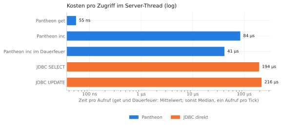
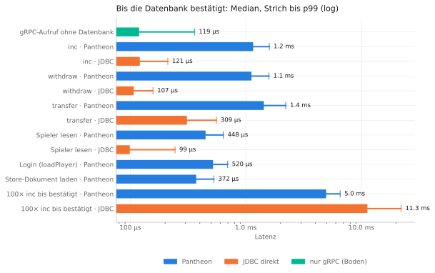
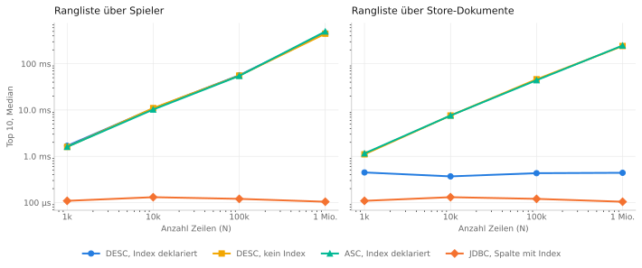
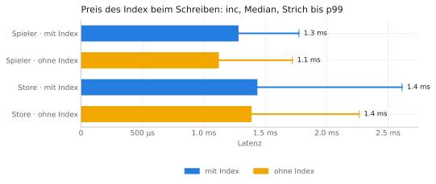
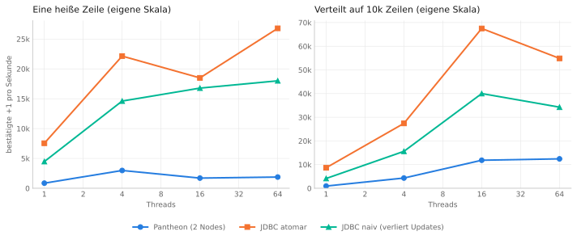
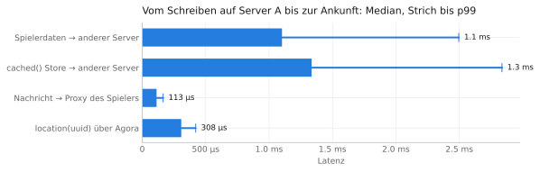
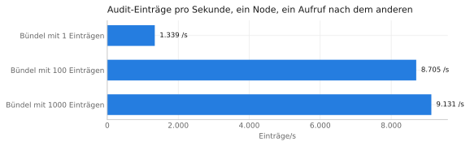

# Pantheon Benchmark

> Stand: 2026-11-28, gemessen auf `v0.2.0-1-g4811fbc` mit dem Benchmark-Code dieses Stands (zum Messzeitpunkt noch
> nicht committet, daher `-dirty` in `env.json`). Rohdaten in
> [benchmark/results](benchmark/results), Grafiken aus [benchmark/charts.py](benchmark/charts.py). Die Zahlen stammen
> aus dem letzten von zwei Volläufen. Einzelne Latenzen schwanken zwischen Läufen stärker als ihr Fehlerbalken
> innerhalb eines Laufs. Wo das auffällt, steht eine Spanne.

## Ist Pantheon schneller?

**Im Server-Thread ja, bei jeder einzelnen bestätigten Operation nein.**

- Lesen kostet 55 ns statt rund 100 bis 200 µs, also drei Größenordnungen weniger. Ein Schreibzugriff im Tick kostet
  44 bis 84 µs statt rund 200 µs.
- Bis die Datenbank eine einzelne Änderung bestätigt, braucht Pantheon etwa zehnmal so lange wie direktes JDBC
  (1,2 ms statt 121 µs).
- Viele Änderungen in Folge fasst Pantheon zusammen. 100 Änderungen sind deshalb etwa doppelt so schnell in der
  Datenbank wie mit JDBC.
- Unter Last verliert Pantheon kein Update. Der naive JDBC-Weg (lesen, ändern, schreiben) verliert bis zu 93 %.

Pantheon tauscht Latenz pro Operation gegen einen freien Tick und korrekte Daten.

---

## Inhalt

1. [Was gemessen wird](#1-was-gemessen-wird)
2. [Umgebung](#2-umgebung)
3. [Kosten im Server-Thread](#3-kosten-im-server-thread)
4. [Bis die Datenbank bestätigt](#4-bis-die-datenbank-bestätigt)
5. [Indizes und Ranglisten](#5-indizes-und-ranglisten)
6. [Nebenläufigkeit](#6-nebenläufigkeit)
7. [Verbreitung, Nachrichten, Presence](#7-verbreitung-nachrichten-presence)
8. [Audit-Log](#8-audit-log)
9. [Grenzen und Empfehlungen](#9-grenzen-und-empfehlungen)
10. [Selbst ausführen](#10-selbst-ausführen)

---

## 1. Was gemessen wird

Jede Pantheon-Zahl steht neben einer **JDBC-Baseline**: dieselbe Aufgabe, von Hand geschrieben, mit HikariCP direkt
gegen dieselbe Postgres-Instanz, mit typisierter Spalte (`coins BIGINT`) statt JSONB. Das ist der beste Fall für ein
Plugin ohne Pantheon.

| Kriterium | Frage | Suite |
|---|---|---|
| Kosten im Server-Thread | Was zahlt der Tick pro `get` bzw. `inc`? | `MainThreadBench` |
| Latenz | Wie lange, bis die Datenbank bestätigt? Median und p99 | `OpLatencyBench` |
| Datenmenge | Wie skaliert eine Top-10-Rangliste von 1k bis 1 Mio. Zeilen, mit und ohne Index? | `IndexBench`, `JdbcIndexBench`, `IndexWriteBench` |
| Nebenläufigkeit | Wie viele bestätigte `+1` pro Sekunde, wie viele gehen verloren? | `ConcurrencyBench` |
| Verbreitung | Wann sieht ein anderer Server eine Änderung? | `PropagationBench`, `MessagingBench` |
| Audit | Wie viele Einträge pro Sekunde, wie schnell ist die Zeitachse? | `AuditBench`, `AuditTimelineBench` |

Gemessen wird mit [JMH](https://github.com/openjdk/jmh) gegen ein echtes Agora im selben Prozess und Postgres 17 in
Docker (`AgoraContractFixture`). Der Benchmark prüft sich selbst und bricht ab, wenn eine Prüfung scheitert:

- Pantheon und JDBC atomar dürfen kein Update verlieren (`consistency.jsonl`).
- Jedes `inc` über den Schreibpfad von `player.data()` muss in Postgres angekommen sein (`stored.jsonl`). „Nichts mehr
  unterwegs“ allein reicht nicht, denn ein gescheiterter Request landet im Outbox.
- Jeder bestätigte Audit-Eintrag muss in `pantheon_audit` stehen (`audit.jsonl`).
- Ob Postgres einen Index benutzt, wird per `EXPLAIN` auf genau dem SQL geprüft, das Agora ausführt, und in
  `index-usage.jsonl` protokolliert.

## 2. Umgebung

| | |
|---|---|
| CPU | AMD Ryzen 9 3900X, 24 Threads |
| RAM | 31 GB |
| Java | 25.0.2 |
| Postgres | 17.10 (`postgres:17-alpine`, Docker) |
| Agora | 0.1.0, Pool 16 Verbindungen (Default) |
| Lauf | 1 Fork, 1×3 s Aufwärmen, 3×3 s Messung pro Benchmark, 25 Minuten insgesamt |

Client, Agora und Postgres laufen auf **einem** Rechner, also ohne Netzwerk-Latenz zwischen den Diensten. Die Zahlen
sind deshalb **relativ** zu lesen: Pantheon gegen JDBC, Index gegen kein Index. In einem echten Netzwerk kommt pro
Hop die Netzwerk-Latenz dazu. Pantheon hat einen Hop mehr (Server → Agora → Postgres) als JDBC (Server → Postgres).

## 3. Kosten im Server-Thread

<picture>
  <source media="(prefers-color-scheme: dark)" srcset="benchmark/main-thread-dark.svg">
  
</picture>

| Zugriff | Pantheon | JDBC |
|---|---:|---:|
| Lesen (`get` bzw. `SELECT`) | 55 ns | 194 µs (p99 811 µs) |
| Schreiben, ein Aufruf pro Tick | 84 µs (p99 309 µs), in drei Läufen 44 bis 84 µs | 216 µs (p99 322 µs) |
| Schreiben im Dauerfeuer auf ein Dokument | 41 µs im Mittel | – |

- **Lesen** kostet Nanosekunden. Es kommt aus dem Speicher und blockiert nie. Selbst ein warmes `SELECT` in der
  Schleife braucht 99 µs (§4).
- **Schreiben ist nicht kostenlos.** Ist für das Dokument gerade kein Request unterwegs, startet `DocWriter` den
  gRPC-Aufruf im aufrufenden Thread (Javadoc von `DocWriter`: „Requests are sent on the calling or completing
  thread“). Das ist ein Drittel bis die Hälfte eines blockierenden `UPDATE`, aber nicht die erhofften Nanosekunden.
- **Dauerfeuer** (`inc` in einer Schleife auf dasselbe Dokument): Solange ein Request unterwegs ist, sammeln sich die
  Ops. Jeder weitere Aufruf kopiert die Liste der unbestätigten Ops und spielt sie neu ab (`DocHandle.addPending`,
  ebenso jedes `get` über `view`). Die Kosten wachsen also mit der Zahl der unbestätigten Ops.
- Pantheon und JDBC werden hier gleich gemessen: ein Aufruf, dann 5 ms Pause wie bis zum nächsten Tick, und vorher
  20 000 Aufrufe zum Aufwärmen, weil ein laufender Server einen warmen JIT hat. Kalt kostet derselbe `inc` 200 bis
  400 µs.

## 4. Bis die Datenbank bestätigt

<picture>
  <source media="(prefers-color-scheme: dark)" srcset="benchmark/latency-dark.svg">
  
</picture>

| Operation | Pantheon p50 | p99 | JDBC p50 | p99 |
|---|---:|---:|---:|---:|
| gRPC-Aufruf ohne Datenbank (Health-Check) | 119 µs | 360 µs | – | – |
| `inc` | 1,2 ms | 1,6 ms | 121 µs | 211 µs |
| `withdraw` | 1,1 ms | 1,6 ms | 107 µs | 157 µs |
| `transfer` | 1,4 ms | 2,2 ms | 309 µs | 556 µs |
| Spieler lesen (`load`) | 448 µs | 638 µs | 99 µs | 244 µs |
| Login (`loadPlayer`) | 520 µs | 696 µs | – | – |
| Store-Dokument laden | 372 µs | 529 µs | – | – |
| 100× `inc` bis alle bestätigt | **5,0 ms** | 6,6 ms | 11,3 ms | 22,1 ms |

- **Lesen:** Ein reiner gRPC-Aufruf zu Agora kostet 119 µs, ein `SELECT` 99 µs. Zusammen erklären sie etwa die Hälfte
  der 448 µs.
- **Schreiben:** Ein bestätigter Schreibzugriff ist in Agora eine Transaktion mit Idempotenz: `BEGIN`, Schlüssel
  beanspruchen, `UPDATE`, Ergebnis speichern, `COMMIT`. Das sind etwa sechs Roundtrips zu Postgres statt einem. Das
  erklärt plausibel den Großteil der ~1,2 ms. Hergeleitet ist das aus dem Code (`WriteService.run`), nicht einzeln
  profiliert.
- **100 Änderungen in Folge:** Hier ist Pantheon etwa doppelt so schnell (in drei Läufen 2,0- bis 2,6-mal).
  `DocWriter` fasst aufeinanderfolgende `inc` auf dasselbe Feld zusammen und schickt höchstens einen Request pro
  Dokument gleichzeitig. Die Baseline schickt 100 Statements.

## 5. Indizes und Ranglisten

<picture>
  <source media="(prefers-color-scheme: dark)" srcset="benchmark/index-dark.svg">
  
</picture>

| Ziel | N | DESC, Index deklariert | DESC, kein Index | ASC | JDBC, Spalte mit Index |
|---|---:|---:|---:|---:|---:|
| Store | 1k | 447 µs | 1,1 ms | 1,2 ms | 109 µs |
| Store | 10k | 368 µs | 7,6 ms | 7,6 ms | 131 µs |
| Store | 100k | 432 µs | 46 ms | 44 ms | 120 µs |
| Store | 1 Mio. | **440 µs** | 242 ms | 248 ms | 104 µs |
| Spieler | 1k | 1,7 ms | 1,6 ms | 1,6 ms | 109 µs |
| Spieler | 10k | 11 ms | 11 ms | 10 ms | 131 µs |
| Spieler | 100k | 57 ms | 55 ms | 55 ms | 120 µs |
| Spieler | 1 Mio. | **459 ms** | 447 ms | 498 ms | 104 µs |

- **Stores:** Mit `index()` bleibt die Top 10 bei jeder Größe unter einer halben Millisekunde. Bei 1 Mio. Dokumenten
  ist das 550-mal schneller als ohne Index. Laut `EXPLAIN` liefert der Index die Reihenfolge, ein Sort-Schritt
  entfällt.
- **Aufsteigend** nutzt den Index nie. Der Index ist `DESC NULLS LAST`, die Abfrage `ASC NULLS LAST`
  ([data.md §4](data.md#4-stores-für-alles-außer-spielern)).
- **Spieler-Ranglisten nutzen den Index nicht, bei keiner Größe.** Agora fragt `FROM pantheon_player p0 LEFT JOIN
  pantheon_player p_<ns>` ab und sortiert nach dem Feld der gejointen Zeile, mit `p0.player` als Tie-Break. Postgres
  sortiert deshalb alle Spieler. Die Dauer wächst linear mit der Zahl der Spieler, bei 1 Mio. ist es fast eine halbe
  Sekunde. Das Verhalten ist in Agora bekannt (E9, `IndexServiceTest.playerDescQueryUsesIndex`), seine Größe war bisher
  nicht gemessen. Im Diagramm liegen die Linien übereinander, „Index deklariert“ ist darunter verdeckt.

<picture>
  <source media="(prefers-color-scheme: dark)" srcset="benchmark/index-write-dark.svg">
  
</picture>

Ein Index macht `inc` im Mittel 0 bis 15 % langsamer, je nach Lauf. In diesem Lauf: Spieler 1,30 ± 0,01 statt
1,14 ± 0,01 ms, Store 1,47 ± 0,02 statt 1,41 ± 0,01 ms. Im vorigen Lauf waren es 3 % bzw. kein messbarer Unterschied.
Gegen den Gewinn beim Lesen (§5 oben) fällt das nicht ins Gewicht.

## 6. Nebenläufigkeit

<picture>
  <source media="(prefers-color-scheme: dark)" srcset="benchmark/concurrency-dark.svg">
  
</picture>

Jeder Thread schreibt `+1` und wartet auf die Bestätigung. Pantheon schreibt von zwei Nodes aus.

| Heiße Zeile | bestätigt | gespeichert | verloren |
|---|---:|---:|---:|
| Pantheon, 64 Threads | 21 973 | 21 973 | **0** |
| JDBC atomar, 64 Threads | 727 660 | 727 660 | **0** |
| JDBC naiv, 4 Threads | 174 911 | 50 481 | **124 430 (71 %)** |
| JDBC naiv, 64 Threads | 340 676 | 24 671 | **316 005 (93 %)** |

- **Korrektheit:** Pantheon verliert in keinem Lauf ein Update. Der naive Weg (lesen, im Code addieren, schreiben)
  verliert auf einer heißen Zeile ab vier Threads die meisten. Auch verteilt auf 10k Zeilen gehen bei 16 Threads 417
  verloren. Diesen Fehler kann man mit Pantheons API nicht machen.
- **Durchsatz einer heißen Zeile:** Pantheon schafft höchstens etwa 3 000 bestätigte Writes pro Sekunde (bei 4
  Threads). Mit mehr Threads sinkt der Wert auf 1 700 bis 1 900, weil die Threads um die Zeilensperre konkurrieren.
  JDBC atomar schafft 18 000 bis 27 000. Agora hält die Sperre über die ganze Idempotenz-Transaktion (§4), JDBC nur für
  ein Statement.
- **Verteilt:** Pantheon erreicht 12 400/s bei 64 Threads, JDBC atomar 55 000/s (67 500/s bei 16 Threads).
- **Pool:** Mehr Verbindungen helfen Pantheon bis 16 deutlich (4: 5 000/s, 16: 12 400/s), darüber wenig
  (32: 14 000/s).

Diese Zahlen zählen **bestätigte Requests**. Ein Plugin, das in einem Tick 100-mal `inc` aufruft, erzeugt dank
Zusammenfassen nur wenige Requests (§4). Plugin-Operationen pro Sekunde liegen deshalb oft weit darüber.

## 7. Verbreitung, Nachrichten, Presence

<picture>
  <source media="(prefers-color-scheme: dark)" srcset="benchmark/propagation-dark.svg">
  
</picture>

| Weg | p50 | p90 | p99 |
|---|---:|---:|---:|
| Spielerdaten → anderer Server (`onDocChanged`) | 1,1 ms | 1,4 ms | 2,5 ms |
| `cached()` Store → anderer Server | 1,3 ms | 1,7 ms | 2,8 ms |
| Nachricht → Proxy des Spielers | 113 µs | 136 µs | 165 µs |
| `location(uuid)` | 308 µs | 359 µs | 421 µs |

Eine Änderung ist nach etwa 1 ms auf dem anderen Server, weit unter einem Tick (50 ms). Gemessen ist die ganze
Strecke: Schreiben, Bestätigung in der Datenbank, Verteilen. Nachrichten gehen über den offenen Stream ohne
Datenbank und sind zehnmal schneller.

## 8. Audit-Log

<picture>
  <source media="(prefers-color-scheme: dark)" srcset="benchmark/audit-dark.svg">
  
</picture>

Einzeln schafft ein Node etwa 1 300 Einträge/s, gebündelt etwa 9 000/s. Pantheon bündelt selbst
([audit_log.md §7](audit_log.md#7-puffer-und-versand)). Ab 100 Einträgen pro Bündel wächst der Durchsatz kaum noch.

**Zeitachse** (neueste Seite, 100 Einträge, eines Spielers):

| Einträge des Spielers | mit Planner-Statistik | direkt nach dem Schreiben, ohne Statistik |
|---|---:|---:|
| 10 000 | 3,0 ms | 43 ms¹ |
| 100 000 | 3,0 ms | **378 ms** |

¹ In diesem Lauf lief Autoanalyze während der Messung, der Median fiel dadurch auf 3,6 ms, p99 blieb 45 ms. In einem
eigenen Lauf lagen alle Werte bei 43 ms.

Mit Statistik bleibt die Abfrage bei 3 ms, egal wie viele Einträge ein Spieler hat. Direkt nachdem viele Einträge in
die Tagespartition geschrieben wurden, bevor Postgres' Autoanalyze lief, wählt der Planner einen Plan, der mit der
Zahl der Einträge wächst: 10- bis 100-mal langsamer. Welcher Plan das ist, ist nicht per `EXPLAIN` geprüft. Ein
Kandidat ist die Bedingung `player = $1 OR target = $1` ([audit_log.md §9](audit_log.md#9-postgres)), die ohne gute
Schätzung zu einem Bitmap-Scan über beide Indizes mit anschließendem Sortieren führen kann.

## 9. Grenzen und Empfehlungen

| Befund | Bedeutung | Empfehlung |
|---|---|---|
| Spieler-Ranglisten ignorieren den Index (§5) | ~11 ms bei 10k, ~460 ms bei 1 Mio. Spielern, pro Abfrage | Bis einige tausend Spieler unkritisch. Darüber das Ergebnis zwischenspeichern (z. B. jede Minute neu) statt pro Aufruf abfragen. In Agora: die Abfrage von der Namespace-Zeile aus führen, damit der Ausdrucks-Index die Reihenfolge liefert |
| Timeline ohne Planner-Statistik (§8) | Bis Autoanalyze läuft, ~400 ms bei 100k Einträgen statt 3 ms | In Agora den Plan per `EXPLAIN` mit und ohne `ANALYZE` vergleichen. Neue Partitionen gezielt analysieren (etwa im Partitions-Job) oder die Abfrage so umbauen, dass sie nicht von Schätzungen abhängt (zwei nach `id DESC` sortierte Teilabfragen für `player` und `target` mit je `LIMIT`) |
| `inc` im Server-Thread kostet 44–84 µs, wenn für das Dokument nichts unterwegs ist (§3) | Viele erste Writes auf verschiedene Dokumente im selben Tick summieren sich. Wie stark, ist nicht gemessen, gemessen ist ein Aufruf pro Tick | Den gRPC-Aufruf im `DocWriter` auf einem eigenen Executor starten |
| Dauerfeuer auf ein Dokument (§3) | Kosten pro `inc` und `get` wachsen mit den unbestätigten Ops | In `DocHandle` die Pending-Liste ebenso zusammenfassen wie den Request, statt sie bei jedem Aufruf zu kopieren und neu abzuspielen |
| Bestätigte Writes ~10× langsamer als JDBC (§4) | Wer auf `withdraw` oder `atomic` wartet, wartet ~1 ms | Für Käufe in Ordnung. Nie im Tick blockierend warten (`join()`) |
| Heiße Zeile höchstens ~3 000 Writes/s (§6) | Ein globaler Zähler für alle Spieler ist der Engpass | Pro Spieler oder pro Server zählen und summieren |

## 10. Selbst ausführen

```bash
./gradlew :core:benchmark                          # alles, ~25 min, braucht Docker
./gradlew :core:benchmark -Pbench.quick            # Schnelllauf zum Prüfen, N ≤ 10k
./gradlew :core:benchmark -Pbench=Index            # nur Läufe, deren Name passt (Regex); der Rest bleibt liegen
./gradlew :core:benchmark -Pbench=OpLatency -Pbench.prof=jfr   # mit Profiler (stack, gc, jfr, ...)
uv run docs/benchmark/charts.py core/build/results/jmh        # Ergebnisse übernehmen, Grafiken und Tabellen neu
```

Ein voller Lauf leert `core/build/results/jmh`, ein gefilterter ersetzt nur seine eigenen Dateien. Die `*.jsonl`-
Protokolle hängen bei gefilterten Läufen an. Die Benchmarks liegen in `core/src/jmh/java`. Sie laufen nie in CI,
denn Zahlen von geteilten Runnern sind zu verrauscht.
